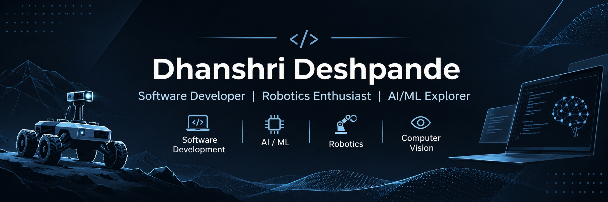

<!-- ================================================= -->
<!--                 PROFILE BANNER                    -->
<!-- ================================================= -->

  

<h1 align="center">Hi 👋, I'm Dhanshri Deshpande</h1>

<h3 align="center">
  Software Developer | Robotics Enthusiast | AI/ML Explorer
</h3>

  Passionate about building intelligent systems, developing innovative solutions,
  and solving real-world engineering challenges.

  
  
  

---

## 👩‍💻 About Me

- 🎓 Information Technology student at **Vishwakarma Institute of Technology, Pune**.
- 💻 Interested in Software Development, Artificial Intelligence and Robotics.
- 🤖 Exploring autonomous navigation, ROS 2, computer vision and robotic simulation.
- 🧠 Passionate about developing intelligent applications and solving real-world problems.
- 🚀 Currently exploring innovative technologies and building practical engineering solutions.
- 🤝 Open to collaboration, hackathons and exciting technology projects.

---

## 🛠️ Technical Skills

### Programming Languages

  
  
  
  

### Robotics & Simulation

  
  
  
  

### Computer Vision & Development

  
  
  

---

## 🚀 Featured Projects

### 🤖 1. Autonomous UGV Navigation in GPS-Denied Outdoor Environments

Developing a simulation-based autonomous Unmanned Ground Vehicle (UGV) for navigation in GPS-denied outdoor environments.

**Key Features:**
- Autonomous navigation using ROS 2 and Nav2.
- Environment mapping and localization using RTAB-Map.
- YOLO-based object detection and obstacle perception.
- Integration of RGB-D camera and IMU data.
- Path planning and autonomous obstacle avoidance.

**Technologies:** `ROS 2` `Nav2` `RTAB-Map` `YOLO` `RGB-D Camera` `IMU` `Gazebo`

---

### 💾 2. Mini SQL Engine – Custom Database Management System

Developed a lightweight SQL-like database engine in Python to simulate core Database Management System functionalities.

**Key Features:**
- Custom SQL parser supporting DDL and DML operations.
- DDL: CREATE, ALTER, DROP, RENAME and TRUNCATE.
- DML: INSERT, SELECT, UPDATE and DELETE.
- Implemented PRIMARY KEY, FOREIGN KEY, UNIQUE, NOT NULL and CHECK constraints.
- Automatic constraint validation and referential integrity.
- JSON-based schema management and CSV-based persistent storage.

**Technologies:** `Python` `JSON` `CSV` `DBMS` `SQL`

---

### 🧠 3. Contexa – AI-Powered Browser Assistant

Developed an AI-powered Chrome extension that helps users understand and interact with online content and documents.

**Key Features:**
- Explains and summarizes selected text from web pages.
- Translates selected content.
- Answers questions based on selected text.
- Supports multiple document formats.
- Provides contextual assistance directly within the browser.

**Technologies:** `Artificial Intelligence` `Chrome Extension` `JavaScript` `Web Technologies`

---

## 🏆 Achievements & Recognition

  

**🥈 2nd Runner-Up – MAHE Mobility Challenge 2026**

Secured second runner-up position in a national-level mobility and innovation hackathon organized by Manipal Institute of Technology (MAHE).

  

**🤖 All India Rank 6 – DD Robocon India 2026**

Achieved All India Rank 6 while representing the institute in the national-level robotics competition.

---

## 🎯 Positions of Responsibility

**Technical Member – The Robotics Forum**

Vishwakarma Institute of Technology, Pune

- Delivered a technical workshop on Python and OpenCV for first-year students.
- Introduced programming fundamentals and basic computer vision concepts.
- Contributed to technical learning and knowledge-sharing activities.

---

## 🎓 Education

| Qualification | Institution | Score |
|---|---|---|
| B.Tech – Information Technology | Vishwakarma Institute of Technology, Pune | CGPA: 9.26 |
| Class XII – CBSE | Art Science Commerce College, Ratnapuri | 70.00% |
| Class X – SSC | Nutan Kanya Prashala, Selu | 91.80% |

---

## 📊 GitHub Statistics

  
  

  

---

## 🌐 Connect With Me

  
  
  

  📧 dhanshrideshpande99@gmail.com
   
  📱 +91 7058980473

---

<h3 align="center">
  ✨ Building. Learning. Innovating.
</h3>

  Thanks for visiting my GitHub profile! ⭐

